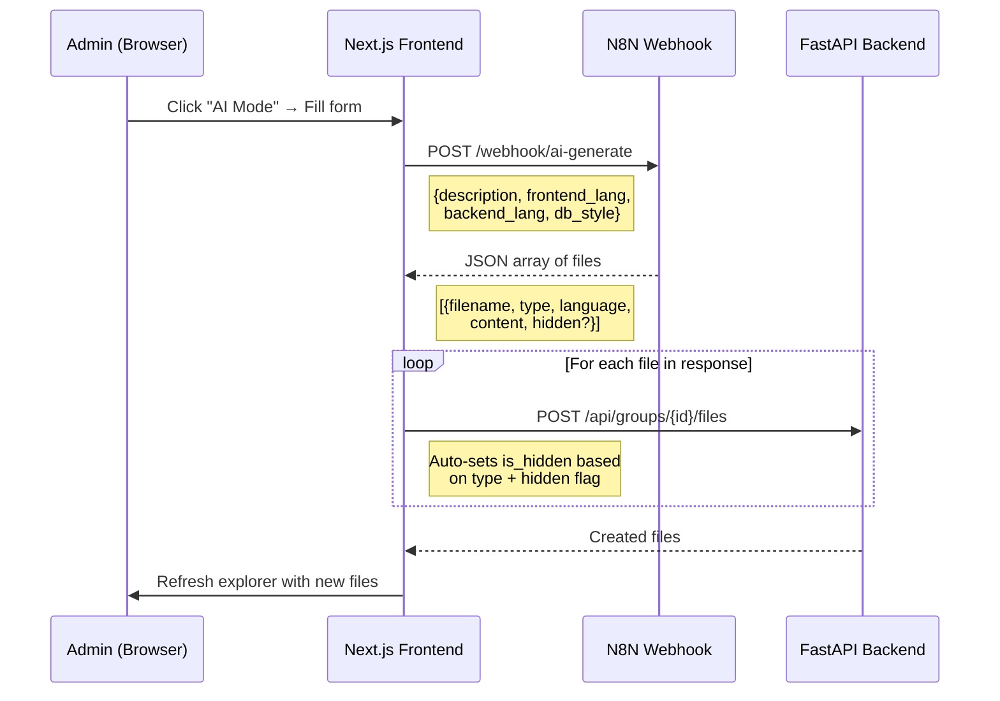

# AI Mode — N8N-Powered Codebase Generator

## Problem & Goal

The admin needs a way to quickly scaffold an entire group workspace using AI. Instead of manually creating files one by one, the admin clicks an **"AI Mode"** button, fills in a short form describing the project, and the system sends this to an N8N webhook. The webhook replies with a structured JSON array of files which are then **auto-created** in the workspace with the correct categories, visibility, and permissions.

## User Review Required

> [!IMPORTANT]
> **N8N Endpoint Configuration**: The N8N webhook URL will be hardcoded as a placeholder (`http://localhost:5678/webhook/ai-generate`) for now. You mentioned we'll figure out the N8N workflow later — we just need the request/response contract defined.

> [!WARNING]  
> **Auto-creation rules** — please confirm these are correct:
> - `testing` files → automatically **hidden** (`is_hidden = true`, only admin sees them)
> - `db` files → **visible** to clients but **read-only** (they can see but not edit)
> - If the N8N response explicitly includes `"hidden": true` → mark as hidden
> - All other files (`frontend`, `backend`) → normal visible + editable for clients

---

## Data Flow



---

## Request Payload (Frontend → N8N)

```json
{
  "description": "A student management system with CRUD operations",
  "frontend_language": "javascript",
  "backend_language": "python",
  "db_style": "sql"
}
```

## Expected Response (N8N → Frontend)

```json
[
  {
    "filename": "app.py",
    "type": "backend",
    "language": "python",
    "content": "from flask import Flask\n\napp = Flask(__name__)\n...",
    "hidden": false
  },
  {
    "filename": "schema.sql",
    "type": "db",
    "language": "sql",
    "content": "CREATE TABLE students (...);",
    "hidden": false
  },
  {
    "filename": "test_app.py",
    "type": "testing",
    "language": "python",
    "content": "import unittest\n...",
    "hidden": false
  },
  {
    "filename": "index.html",
    "type": "frontend",
    "language": "html",
    "content": "<!DOCTYPE html>...",
    "hidden": false
  },
  {
    "filename": "answers.py",
    "type": "backend",
    "language": "python",
    "content": "# Answer key — admin only",
    "hidden": true
  }
]
```

---

## Proposed Changes

### Frontend

#### [MODIFY] [page.js](file:///c:/Users/sigin/OneDrive/Desktop/N8n/grouphub/frontend/src/app/dashboard/group/%5Bid%5D/page.js)

1. **Add `AiModeModal` component** — A premium glassmorphic modal with:
   - Codebase Description (textarea)
   - Frontend Language (dropdown: JavaScript, TypeScript, HTML, React, etc.)
   - Backend Language (dropdown: Python, Java, Node.js, Go, etc.)
   - DB Style (dropdown: SQL, NoSQL/MongoDB, Firebase, None)
   - A "Generate" button that calls the N8N webhook directly from the browser
2. **Add processing logic** — After receiving the N8N response:
   - Loop through each file in the JSON array
   - Determine `is_hidden`: if `type === "testing"` OR `hidden === true` → set `is_hidden = true`
   - Prepend category folder: `{type}/{filename}` (e.g., `backend/app.py`, `db/schema.sql`)
   - Call `api.createFile()` for each file
   - Refresh the file list when done
3. **Add AI Mode button** to the **Activity Bar** (the left icon strip) — only visible to admins
4. **Add a sidebar panel** for AI Mode status (optional, shows progress)

#### [MODIFY] [ide.css](file:///c:/Users/sigin/OneDrive/Desktop/N8n/grouphub/frontend/src/app/ide.css)

- Add styles for the AI Mode modal (animated gradient border, pulsing AI icon, progress bar)

### Backend

No backend changes needed — the frontend will:
1. Call N8N directly (webhook)
2. Use the existing `POST /api/groups/{id}/files` endpoint to create each file

---

## Open Questions

> [!IMPORTANT]
> 1. Should I use a **placeholder N8N URL** like `http://localhost:5678/webhook/ai-generate`, or do you have a specific URL ready?
> 2. For the **DB Style** dropdown, what options do you want? I'm planning: `SQL (PostgreSQL)`, `SQL (MySQL)`, `NoSQL (MongoDB)`, `Firebase`, `None`
> 3. Should the AI Mode button replace files if they already exist, or skip duplicates?

## Verification Plan

### Manual Verification
- Click AI Mode → fill in form → submit
- Verify the request payload structure matches the contract above
- Mock a JSON response and verify files are created with correct categories/visibility
- Verify `testing` files show up only in admin's hidden panel
- Verify `db` files are read-only for clients
